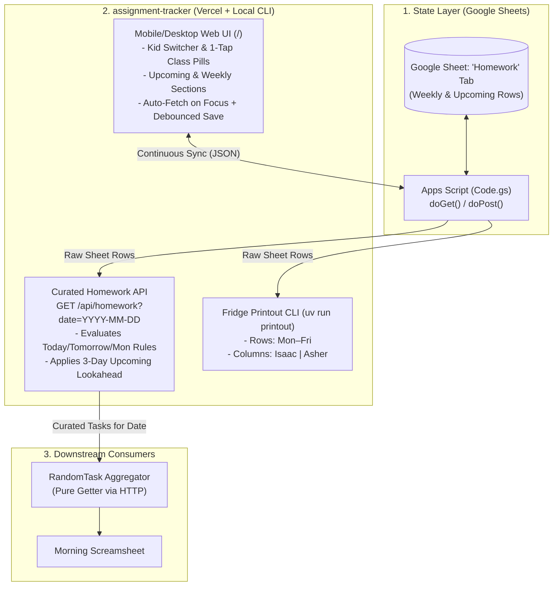

# Homework Tracker v2: Implementation & Architecture Plan

This document serves as the architectural specification and implementation roadmap for replacing the Trello-based homework workflow with a **Google Sheets state layer**, a **mobile-first Web UI on Vercel**, a **date-aware Homework API** in `assignment-tracker`, a **pure-getter adapter** in `RandomTask`, and a **rotated Fridge PDF generator**.

---

## 1. System Overview & Architecture



### Core Design Principles
1. **Two Assignment Categories Only (`Weekly` & `Upcoming`):**
   * **`Weekly`:** Set-and-forget recurring assignments tied to a day of the week (`Monday`–`Friday`). Never requires manual rollover.
   * **`Upcoming`:** Dated assignments, tests, reading chapters, or quarterly projects tied to a specific calendar date (`YYYY-MM-DD`). Automatically appears on the Screamsheet 3 days before the due date and vanishes automatically once the due date passes.
2. **Continuous, Button-Free Sync:**
   * The Google Sheet is the single source of truth. The Web UI automatically pulls fresh data from the Sheet whenever opened or focused, and automatically saves edits back to the Sheet in the background.
3. **Brain in `assignment-tracker`, Getter in `RandomTask`:**
   * All homework business logic (school-day lookahead, Friday-to-Monday bridging, 3-day upcoming radar) lives in `assignment-tracker`. `RandomTask` simply requests `GET /api/homework?date=YYYY-MM-DD` and renders what it receives.

---

## 2. Configuration Schema (`config.yaml`)

[`config.yaml`](file:///C:/Users/Admin/Documents/assignment-tracker/config.yaml) is simplified to link each kid directly to their active classes and define the Google Sheets endpoint and lookahead window. Trello and Gmail IMAP settings are removed.

```yaml
google_sheets:
  sheet_name: "Homework"
  # Deployed Google Apps Script Web App URL (also configurable via GOOGLE_SCRIPT_URL env var)
  script_url: "https://script.google.com/macros/s/YOUR_DEPLOYMENT_ID/exec"

settings:
  upcoming_lookahead_days: 3

kids:
  Isaac:
    color: "blue"
    classes:
      - "Art History"
      - "English Language"
      - "English Literature"
      - "French"
      - "Math"
      - "Math Competition"
      - "Science"

  Asher:
    color: "green"
    classes:
      - "Art History"
      - "English Language"
      - "French"
      - "Math"
      - "Piano"
```

> [!NOTE]
> For the Vercel web deployment, a lightweight build step (or `/api/config` endpoint) serves `config.yaml` as JSON to the frontend so you only ever maintain a single `config.yaml` file.

---

## 3. State Layer: Google Sheet & `Code.gs`

### 3.1 Spreadsheet Tab Schema (`Homework`)
A single tab named **`Homework`** with the following columns:

| Column | Field | Values / Format | Description |
| :--- | :--- | :--- | :--- |
| **A** | `ID` | `hw-172964...` | Unique row ID (auto-generated by UI or `Code.gs` if left blank during manual Sheet edits). |
| **B** | `Kid` | `Isaac` \| `Asher` | Student name matching `config.yaml`. |
| **C** | `Class` | e.g. `French`, `Piano` | Subject name from the kid's class list. |
| **D** | `Type` | `weekly` \| `upcoming` | Case-insensitive category discriminator. |
| **E** | `Title` | e.g. `Spelling Test` | Assignment title. |
| **F** | `Due` | `Friday` or `2026-10-29` | Weekday name (`Monday`–`Friday`) for `weekly`; ISO date (`YYYY-MM-DD`) for `upcoming`. |
| **G** | `Notes` | Optional text | Extra details or instructions. |
| **H** | `Active` | `TRUE` \| `FALSE` | Defaults to `TRUE`. Allows temporarily pausing a `weekly` rule without deleting it. |
| **I** | `UpdatedAt` | ISO-8601 timestamp | Last modified timestamp. |

### 3.2 Google Apps Script Bridge (`Code.gs`)
Modeled directly after [`budget-app/Code.gs`](file:///C:/Users/Admin/Documents/budget-app/Code.gs):
* **`doGet(e)`:**
  * Reads all rows from the `Homework` sheet.
  * If a row was added manually in Google Sheets without an `ID`, generates a stable ID and writes it back to Column A.
  * Normalizes Google Sheets date objects in the `Due` column into clean `YYYY-MM-DD` strings.
  * Returns the array of homework objects as JSON.
* **`doPost(e)`:**
  * Accepts a JSON payload from the Web UI:
    * Full sync (`action: "replace_all"`): Replaces the table contents cleanly with the updated array of items.
    * Granular item upsert/delete (`action: "upsert"` / `"delete"`): Updates or removes a single row by `ID` so rapid edits never clobber concurrent changes.

---

## 4. Web UI Specification (`index.html` + `js/app.js`)

Hosted at the root (`/`) of the `assignment-tracker` Vercel project. Designed mobile-first for one-handed phone use and fast desktop editing.

### 4.1 Layout & Interaction Flow
1. **Top Header Bar:**
   * **Kid Switcher:** Large segmented control `[ Isaac ]` | `[ Asher ]`. Tapping switches the active kid context and applies their theme color (`blue` vs. `green`).
   * **Sync Status Pill:** Displays `✓ Synced`, `Saving...`, or `⚠ Offline` next to a subtle `↻` manual refresh icon.
2. **Quick-Add Card (Pinned below Header):**
   * **Class Pill Selector:** Horizontal wrap of 1-tap pill buttons showing *only* the selected kid's classes from `config.yaml` (e.g., for Asher: `Art History`, `English Language`, `French`, `Math`, `Piano`).
   * **Title Input:** Single-line input (`"What's the assignment?"`) + optional collapsible Notes field.
   * **Type & Due Picker:**
     * Segmented toggle: **`[ 📌 Upcoming ]`** (default) vs **`[ 🔁 Weekly ]`**.
     * When **`Upcoming`** is active: Shows quick-tap date chips **`[ Tomorrow ]`**, **`[ Friday ]`**, **`[ Monday ]`**, and **`[ 📅 Pick Date ]`** (native mobile date picker). *(Note: If today is Thursday, the `[ Tomorrow (Fri) ]` chip and `[ Monday ]` chip adjust smartly so there are no duplicate chips).*
     * When **`Weekly`** is active: Shows 5 weekday chips **`[ Mon ]` `[ Tue ]` `[ Wed ]` `[ Thu ]` `[ Fri ]`**.
3. **Section 1: 📌 Upcoming (Top List)**
   * Displays active `upcoming` items for the selected kid, sorted chronologically by due date (`Due Today`, `Due Tomorrow`, `Due Fri, Oct 30`).
   * **Inline Editing:** Tapping an item's title, class, or date allows instant inline editing.
   * **Auto-Expiry:** Items with `Due < Today` are automatically hidden from the main list (accessible via a collapsed *"Show Past Due / Completed"* toggle at the bottom if you ever want to resurrect or review old items).
   * **Delete (`✕`):** Single tap removes the item.
4. **Section 2: 🔁 Weekly (Bottom List)**
   * Displays `weekly` recurring items for the selected kid, ordered `Monday` through `Friday`.
   * Includes an **Active toggle switch** on each row (to pause a weekly habit for a week) and inline editing for the title/day.

### 4.2 Continuous Sync Mechanics
* **Automatic Pull (Sheet ➔ UI):**
  * Triggers on initial page load (`DOMContentLoaded`) and whenever the browser tab regains focus (`window.addEventListener('focus', ...)` and `document.addEventListener('visibilitychange', ...)`).
  * If you edit the Google Sheet directly in another tab and switch back to the Web UI, the UI updates automatically within ~300ms.
* **Automatic Push (UI ➔ Sheet):**
  * Uses **Optimistic UI**: UI state updates immediately on tap/type, and a 500ms debounced background `POST` writes the updated state to `Code.gs`.
* **Future Enhancement (Not in v1):**
  * *Optional 60-second background idle poll:* If the Web UI is left open simultaneously on two devices while actively editing the Sheet, a periodic 60s background poll can be added later if focus-based fetching ever feels insufficient.

---

## 5. Curated Homework API & Date Evaluation Logic

### Endpoint: `GET /api/homework`
* **Query Parameters:**
  * `date` *(optional, defaults to today in `America/New_York`)*: Target date in `YYYY-MM-DD` format (e.g., `GET /api/homework?date=2026-10-23`).

### 5.1 School-Day & Lookahead Rules
Given a target `ref_date` (`YYYY-MM-DD`):

1. **Determine Active School Days for `Weekly` Assignments:**
   * **Monday – Thursday:** Include active `weekly` items due on **`ref_date` (Today)** and **`ref_date + 1 day` (Tomorrow)**.
   * **Friday:** Ignore Saturday & Sunday. Include active `weekly` items due on **`Friday` (Today)** and **`Monday` (`ref_date + 3 days`)**.
   * **Saturday:** Ignore weekend. Include active `weekly` items due on **`Monday` (`ref_date + 2 days`)**.
   * **Sunday:** Ignore weekend. Include active `weekly` items due on **`Monday` (`ref_date + 1 day`)**.

2. **Determine Lookahead Window for `Upcoming` Assignments:**
   * Let `lookahead_end = max(next_school_day, ref_date + 3 days)`.
   * Include any active `upcoming` item whose `due_date` satisfies:
     $$\text{ref\_date} \le \text{due\_date} \le \text{lookahead\_end}$$
   * **Result:**
     * Any `upcoming` test or project starts appearing on the Screamsheet **3 calendar days in advance** and persists each morning until its due date.
     * On Friday (`ref_date`), `ref_date + 3 days` is already Monday, so Monday `upcoming` items naturally appear on Friday's Screamsheet alongside Monday `weekly` items.
     * As soon as `due_date < ref_date` (the day *after* it was due), the item automatically drops off the Screamsheet. Zero manual cleanup required.

### 5.2 Response Payload Format
Returns a clean JSON payload ready for `RandomTask` to ingest:

```json
{
  "date": "2026-10-23",
  "next_school_day": "2026-10-26",
  "tasks": [
    {
      "id": "hw-101",
      "kid": "Asher",
      "class": "English Language",
      "type": "weekly",
      "title": "[English Language] Spelling Test & Workbook",
      "raw_title": "Spelling Test & Workbook",
      "due": "2026-10-23",
      "due_label": "DUE TODAY (Fri)",
      "priority": "high",
      "cover_color": "green",
      "notes": ""
    },
    {
      "id": "hw-102",
      "kid": "Asher",
      "class": "Piano",
      "type": "weekly",
      "title": "[Piano] Hand in Piano log",
      "raw_title": "Hand in Piano log",
      "due": "2026-10-26",
      "due_label": "DUE MON",
      "priority": "medium",
      "cover_color": "green",
      "notes": ""
    }
  ]
}
```

---

## 6. `RandomTask` Getter Integration

In [`random-task`](file:///C:/Users/Admin/Documents/random-task):
1. Add a lightweight `HomeworkApiAdapter` in `src/adapters/homework-api.ts` (and wire it into `src/pipeline/01-ingest.ts`).
2. In `random-task/config.json`, replace the Homework Trello board entry with:
   ```json
   "homework": {
     "api_url": "https://your-assignment-tracker.vercel.app/api/homework"
   }
   ```
   *(The "Home Maintenance" board in `random-task` continues using `TrelloAdapter` untouched).*
3. When `random-task` runs for `--date YYYY-MM-DD`, `HomeworkApiAdapter` performs a single `GET ${api_url}?date=${targetDate}` call and maps the returned `tasks` directly into the `Homework` section of `agenda-YYYY-MM-DD.json`.

---

## 7. Rotated Fridge PDF Printout (`uv run printout`)

[`src/printout.py`](file:///C:/Users/Admin/Documents/assignment-tracker/src/printout.py) will be updated in two ways:

### 7.1 Data Source: Google Sheet Instead of Trello
* Fetches raw rows from the Google Sheet `script_url` in `config.yaml` (and caches a local snapshot to `workspace/homework_snapshot.json` for `--offline` mode).
* For the target Monday–Friday week (`start_date` to `end_date`):
  * Every active `weekly` item is mapped to its corresponding weekday (`Monday`–`Friday`) in that week.
  * Every active `upcoming` item whose `due` date falls within that Monday–Friday week (with Sunday rolling to Monday and Saturday rolling to Friday, as before) is merged into that day.

### 7.2 Rotated Matrix Layout (Days = Rows, Kids = Columns)
Instead of 5 narrow vertical day columns across the page, the printout renders a clean **5-Row × 2-Kid Matrix**:

| Day | ISAAC | ASHER |
| :--- | :--- | :--- |
| **MONDAY**<br>Oct 26 | **ART HISTORY**<br>`[ ]` Google Classroom | **PIANO**<br>`[ ]` Hand in Piano log |
| **TUESDAY**<br>Oct 27 | | **FRENCH**<br>`[ ]` Watch moi, c'est twice<br>`[ ]` Homework Packet<br>**MATH**<br>`[ ]` Beast Academy Book |
| **WEDNESDAY**<br>Oct 28 | **ENGLISH LANGUAGE**<br>`[ ]` Spelling Test<br>`[ ]` Trad Spelling, Ch 1<br>**ENGLISH LITERATURE**<br>`[ ]` Read P&P v2, Ch 1-14 | |
| **THURSDAY**<br>Oct 29 | **FRENCH**<br>`[ ]` Ch 1 Test<br>**MATH COMPETITION**<br>`[ ]` Work Packet 1 Hour! | |
| **FRIDAY**<br>Oct 30 | | **ENGLISH LANGUAGE**<br>`[ ]` Spelling Test<br>`[ ]` Workbook Pages |

* **Design:** Spartan black-and-white, sharp right-angled borders, generous horizontal width per kid so descriptions word-wrap cleanly without cramping, fitted to a single page.

---

## 8. File & Implementation Roadmap

1. **Phase 1: Config & Google Sheet Backend (`assignment-tracker`)**
   * Update [`config.yaml`](file:///C:/Users/Admin/Documents/assignment-tracker/config.yaml) to the new Kid ➔ Classes + Google Sheet schema.
   * Create `Code.gs` for the Google Sheet (`Homework` tab) with seed migration support for existing items from [`workspace/homework.yaml`](file:///C:/Users/Admin/Documents/assignment-tracker/workspace/homework.yaml).
2. **Phase 2: Web UI & Curated API (`assignment-tracker` for Vercel)**
   * Build `index.html`, `css/styles.css`, and `js/app.js` (Kid switcher, 1-tap Class pills, `Upcoming` & `Weekly` sections, focus auto-fetch, debounced auto-save).
   * Build `/api/homework` serverless endpoint implementing the Today/Tomorrow/Monday & 3-day Upcoming lookahead logic.
   * Build `/api/config` endpoint (or build script) so the Web UI reads `config.yaml` directly.
3. **Phase 3: Rotated Fridge Printout & CLI Cleanup (`assignment-tracker`)**
   * Update [`src/printout.py`](file:///C:/Users/Admin/Documents/assignment-tracker/src/printout.py) to fetch from Google Sheets and render the rotated `Mon–Fri` (rows) × `Isaac | Asher` (columns) table.
   * Simplify [`main.py`](file:///C:/Users/Admin/Documents/assignment-tracker/main.py), removing obsolete Trello (`pull`/`push`) and Gmail (`ingest`) commands.
4. **Phase 4: `RandomTask` Getter Adapter (`random-task`)**
   * Add `HomeworkApiAdapter` to `random-task` to query `/api/homework?date=YYYY-MM-DD`.

---

## 9. What You Have to Do (And Exact Timing)

You don't need to do **anything** until I finish writing the code for Phase 1 & Phase 2. Once the code is ready, there are only **two manual tasks** you'll need to do in your browser (about 5 minutes total).

### ⏱️ When to do Task 1: After I generate `Code.gs` (End of Phase 1/2)
#### Task 1: Create the Google Sheet & Paste `Code.gs` (~3 minutes)
Google requires a human to click "Deploy" inside their spreadsheet. Here is the exact click-by-click recipe:

1. Go to [Google Sheets](https://sheets.google.com) and click **Blank spreadsheet**.
2. Name the spreadsheet at the top-left (e.g., **`Homework Tracker`**).
   *(You don't even need to create headers or rename tabs—`Code.gs` will automatically create the `Homework` tab and column headers for you on its first run).*
3. In the top menu bar, click **Extensions** ➔ **Apps Script**.
4. You'll see a code editor with `function myFunction() { }`. **Select all of that and delete it.**
5. Open the `Code.gs` file I create in this folder, **copy the entire file**, and **paste it** into the Apps Script editor.
6. Press `Ctrl+S` (or click the **💾 Save** icon at the top).
7. In the top-right corner, click the blue **Deploy** button ➔ **New deployment**.
8. On the left side of the popup, click the **⚙️ Gear icon** next to *"Select type"* and choose **Web app**.
9. Fill in the three boxes:
   * **Description:** `Homework Bridge`
   * **Execute as:** **`Me`** *(your Gmail address)*
   * **Who has access:** **`Anyone`** *(⚠️ Crucial! Pick "Anyone", NOT "Only myself", so Vercel and your local printout script can reach it without a Google login popup).*
10. Click **Deploy**.
11. **Google Permission Popup:** Google will ask you to authorize your own script:
    * Click **Authorize access** ➔ click your Google account.
    * You'll see a warning screen ("Google hasn't verified this app"). Click **Advanced** (small text at the bottom left).
    * Click **Go to Untitled project (unsafe)** at the bottom.
    * Click **Allow**.
12. Google will show you a **Web app URL** that looks like `https://script.google.com/macros/s/AKfycb.../exec`.
13. **Click "Copy"** and paste that URL right here in our chat! *(I will put it into `config.yaml` and populate the sheet with your initial Weekly assignments automatically).*

---

### ⏱️ When to do Task 2: After I build the Web UI & push to GitHub (End of Phase 2)
#### Task 2: Click "Import" on Vercel (~2 minutes)
Once I commit and push the new Web UI and API code to your GitHub repo:

1. Go to [vercel.com](https://vercel.com/dashboard) and log in (same account where your `budget-app` lives).
2. Click the **Add New...** button (top right) ➔ **Project**.
3. Under **Import Git Repository**, find **`assignment-tracker`** and click **Import**.
4. You don't need to change any build settings—just click the big **Deploy** button.
5. Wait ~30 seconds for it to finish building.
6. Copy the live URL Vercel gives you (e.g., `https://assignment-tracker-xyz.vercel.app`) and paste it to me here in chat so I can point `RandomTask` at it.
7. **On your phone:** Open that Vercel URL in your phone's browser, tap the browser menu (**Share** on iPhone / **⋮** on Android), and tap **Add to Home Screen**. Now you have a 1-tap Homework icon on your phone!

